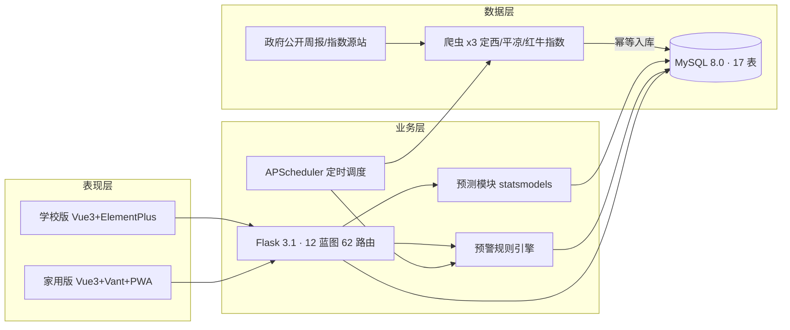

# 甘肃牛羊价格统计预测与趋势分析平台（gansu-livestock）

> **一句话**：自动抓取甘肃政府发布的牛羊价格周报，做统计分析和 ARIMAX 价格预测，
> 给家庭牧场一个"现在能不能卖"的大白话建议。

## 核心功能

1. **多源价格采集**：定西/平凉畜牧局周报 + 平凉红牛指数三个幂等爬虫，定时自动抓取入库
2. **统计分析**：趋势/地区对比/同比环比/价格关联分析，四色来源标签（政府绿/反推灰/指数蓝/示例黄）
3. **价格预测**：ARIMA/ARIMAX 双模型（玉米价作外生变量），AIC 定阶 + 留出法回测 + 95% 置信区间
4. **价格预警**：跌破成本线/涨超阈值/连续涨跌四类规则，每小时巡检主动提醒
5. **家庭决策**：成本计算器、出栏建议（四分支+人话理由）、存栏/饲料/账本，手机 PWA 直接用

## 技术栈

| 层 | 技术 |
|---|---|
| 后端 | Python 3.14 · Flask 3.1（12 蓝图 62 路由）· SQLAlchemy 2.1 · PyJWT · bcrypt · APScheduler |
| 前端 | Vue 3 · Element Plus（学校版）/ Vant 4 + PWA（家用版）· ECharts 5 · Vite |
| 数据库 | MySQL 8.0（17 表，utf8mb4，source × is_sample 双标记体系） |
| 预测 | statsmodels（SARIMAX/ARIMA）· pandas（预处理：插值/ADF 检验） |

## 系统架构



## 主要成果（2026-10-10 实测）

| 指标 | 数值 |
|------|------|
| 真实数据 | **188 条**（定西周报 148 + 平凉周报 36 + 红牛指数 4）+ 反推补全 40 条 |
| 预测精度 | 活牛 ARIMAX **MAPE 0.75%**（优秀线 10%）、牛肉 0.96% |
| 价格分类 | 8 个（活牛/牛肉/活羊/羊肉/玉米/豆粕/麸皮/苜蓿草）|
| 数据库 | 17 张表，source × is_sample 双标记（真实/反推/示例隔离）|
| 接口 | 62 条 RESTful 路由（12 模块）|
| 测试 | 28 项 pytest 全过 + 七轮人工验收 |
| 部署 | 局域网生产模式运行中（家人手机可访问）|

**系统架构**（mermaid 版见上方"系统架构"节）：

```
学校版(Vue3+ElementPlus) ─┐                          ┌─ 爬虫×3：定西/平凉/红牛指数（幂等）
家用版(Vue3+Vant) ────────┼─ Flask 62路由 + 预测/预警 ┼─ MySQL 17表（双标记）
                         ┘   + APScheduler 定时      └─ 示例数据(is_sample=1)
```

## 怎么运行（3 步）

```bash
# 1. 后端（MySQL 已建库 gansu_livestock）
cd backend && set DB_PASSWORD=你的密码 && APP_MODE=school venv\Scripts\python.exe app.py
# 2. 生产模式双前端（8082 学校版 / 8081 家用版）
..\backend\venv\Scripts\python.exe scripts\serve_prod.py
# 3. 浏览器打开 http://127.0.0.1:8082（admin/admin123 或演示账号 demo/demo123）
```

（开发模式：两前端 `npm run dev`，Vite 代理到 5000；详见[部署指南](docs/部署指南.md)）

## 数据从哪来

- **政府周报**（source=gov）：定西市/平凉市畜牧兽医局每周转载的农业农村部监测数据，
  爬虫每周一 09:00 自动抓取
- **红牛指数**（source=index）：新华·平凉红牛价格指数月报，每月 1 日抓取
- **贩子报价**（source=dealer）：家人 Excel 记录经"一键导入"入库（独家实际成交参考）
- **反推补全**（source=derived）：活牛 0.38/活羊 0.42 系数反推（[核实报告](docs/反推系数核实.md)），
  仅用于预测补全、不进统计
- **示例数据**（is_sample=1）：3952 条开发演示用，默认全部隐藏

## 项目简介（面向家人）

围绕三个核心问题：

1. **现在行情怎么样？** —— 活牛、活羊、牛肉、羊肉、饲料（玉米/豆粕/麸皮/苜蓿草）价格监测
2. **能不能卖？** —— 出栏利润、压栏利润、盈亏平衡价计算，规则+预测的出栏建议
3. **以后价格会怎么样？** —— ARIMA/ARIMAX 时间序列预测，饲料价与牛羊价关联分析

## 双版本

| 维度 | 学校版（frontend-school） | 家用版（frontend-home） |
|---|---|---|
| 用途 | 毕业设计答辩 | 家里实际使用 |
| UI | Vue3 + Element Plus + ECharts | Vue3 + Vant + ECharts |
| 设备 | 电脑浏览器 | 手机浏览器 / PWA |
| 特色 | 数据大屏、预测、关联分析、后台 | 成本计算器、出栏建议、账本、存栏 |

一套后端（backend/，Flask + SQLAlchemy + MySQL），两个前端，共用数据层和预测层。

## 目录结构

```
gansu-livestock/
├── backend/            # Flask 后端（API、service、model、utils、sql）
├── frontend-school/    # 学校版前端（Element Plus）
├── frontend-home/      # 家用版前端（Vant）
├── spider/             # 爬虫（政府价格、饲料价格、清洗、入库）
├── predict/            # 预测模型（预处理、ARIMA、ARIMAX、评价）
├── data/               # 数据文件（爬虫输出、备份）
├── docs/               # 文档（需求、技术方案、数据库、API、开发计划）
├── .gitignore
└── README.md
```

## 快速开始

```bash
# 后端
cd backend
F:\programer\software\python3.14\python.exe -m venv venv
venv\Scripts\activate
pip install -r requirements.txt
# 初始化数据库（Navicat 或命令行执行 sql/init.sql + sql/init_data.sql）
python app.py

# 前端（学校版）
cd frontend-school
npm install
npm run dev

# 前端（家用版）
cd frontend-home
npm install
npm run dev
```

> 演示账号：admin / admin123（仅本地开发和答辩演示用）

## 当前进度（2026-10-10）

| 模块 | 状态 | 说明 |
|---|---|---|
| 后端 | ✅ 可跑 | 64 路由，17 接口冒烟全 200，8 分类 ARIMAX 全 PASS（MAPE 0.7%—3.0%） |
| 单元测试 | ✅ | pytest 22/22 通过（接口/预测/成本计算） |
| 数据库 | ✅ | 17 表 + 初始数据 + 3952 条示例价格（2023-01 ~ 2026-10） |
| 学校版前端 | ✅ 可构建 | npm install + vite build 通过（dist 2.7M） |
| 家用版前端 | ✅ 可构建 | npm install + vite build 通过（dist 1.7M），首页默认定西真实数据+示例回退 |
| 爬虫 | ✅ 两源落地 | 定西畜牧局 148 条 + 平凉红牛指数 4 期（见下"当前数据状态"） |
| 预警/定时任务 | ✅ | 3 条规则 + alert_check_job 每小时巡检已接入 scheduler |
| 家用版模式 | ✅ | `APP_MODE=home` 8 步流程全通（第二轮实测） |

已知问题：饲料类分类做 ARIMAX 时外生变量默认与主序列相同（玉米↔玉米），置信区间坍缩为 0，
点预测仍有效，改法见 docs/一天工作报告.md。

## 当前数据状态（2026-10-10）

**真实数据 152 条（is_sample=0，默认查询可见）：**

| 数据源 | source | 条数 | 覆盖地区 | 覆盖时段 | 频率 |
|--------|--------|------|---------|---------|------|
| 定西市畜牧兽医局周报 | gov | 148 | 定西市 | 2024-06-26 ~ 2026-10-10（32 周） | 周 |
| 新华·平凉红牛价格指数月报 | index | 4 | 平凉市 | 2026-04-30 ~ 2026-08-31 | 月 |

- 定西覆盖 6 分类：牛肉/羊肉/玉米/豆粕各 31 周，活牛 13、活羊 11（源站并非每周发布活畜价）
- 平凉为活牛分类，remark 存指数点位与 S 级胴体价格
- 示例数据 3952 条（is_sample=1）仅在看板勾选"含示例数据"（`include_sample=true`）时可见
- 明细见 [数据覆盖度](docs/数据覆盖度.md)、[数据源地图](docs/数据源地图.md)

## 数据导出

`GET /api/price/export?region_id=12&category_id=1` 导出 CSV（UTF-8 BOM，Excel 直开），
字段含日期/地区/分类/价格/来源/备注；学校版页面也可直接下载（`/api/price/export` 链接）。
默认仅导出真实数据，`include_sample=true` 含示例。

## 报告生成

```bash
cd backend && set DB_PASSWORD=***
venv\Scripts\python.exe scripts\gen_weekly_report.py          # 本周周报
venv\Scripts\python.exe scripts\gen_monthly_report.py 2026-09  # 指定月月报（含走势图）
```

输出到 `docs/reports/`（weekly_YYYY-MM-DD.md / monthly_YYYY-MM.md + png），
含核心四项价格、环比同比、异常提示、下周 ARIMAX 预测；数据不足自动提示跳过。

## 部署

Docker 编排已就绪（MySQL + backend + nginx，双前端 dist 已复制到 deploy/html）：

```bash
export DB_PASSWORD=你的密码
docker compose up -d          # 首次自动导入 init.sql
curl http://127.0.0.1/api/health
```

详见 [部署指南](docs/部署指南.md)（含 Tailscale 家用版远程访问、常见问题）。

## 文档

- [需求文档](docs/需求文档.md)
- [技术方案](docs/技术方案.md)
- [数据库设计](docs/数据库设计.md)
- [API 接口文档](docs/API接口文档.md)
- [部署指南](docs/部署指南.md)（含 Docker、Tailscale 远程访问）
- [数据覆盖度](docs/数据覆盖度.md) · [数据源地图](docs/数据源地图.md)
- [反推系数核实](docs/反推系数核实.md)
- [开发计划](docs/开发计划.md)

## 许可证

[MIT License](LICENSE)（Copyright (c) 2026）
