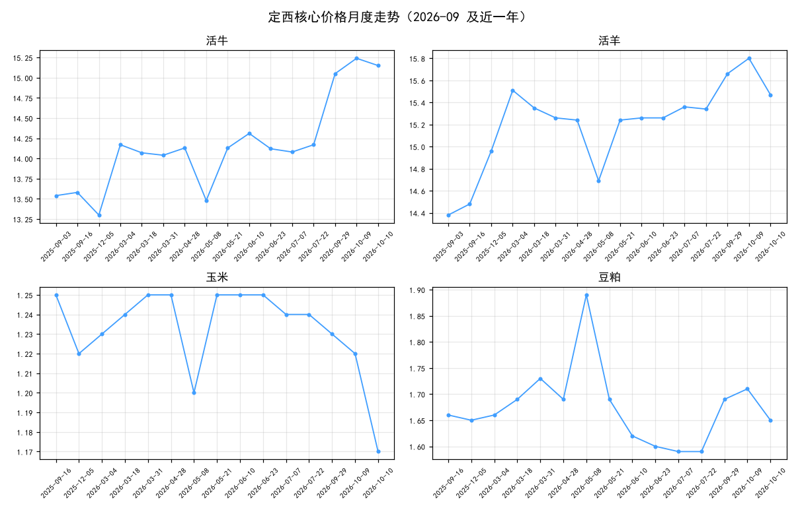

# 价格月报（2026-09）

| 分类 | 月均(元/斤) | 数据点数 | 环比% | 同比% |
|------|------------|---------|-------|-------|
| 活牛 | 15.05 | 1 | +6.2 | — |
| 活羊 | 15.66 | 1 | +2.1 | — |
| 玉米 | 1.23 | 1 | -0.8 | — |
| 豆粕 | 1.69 | 1 | +6.3 | — |

*数据源：定西市畜牧兽医局周报（gov）+ 反推补全（derived），默认不含示例数据。*
*生成时间：2026-10-10 19:24*