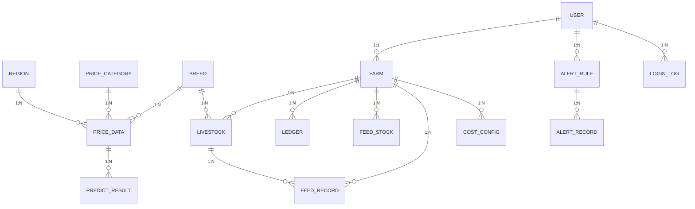

# 数据库表结构（gansu_livestock，17 表）

> 生成于 2026-10-10（替代 Navicat 截图，论文用）

## alert_record 预警记录
| 列 |
|----|
| category_id |
| id |
| is_read |
| message |
| push_status |
| region_id |
| rule_id |
| trigger_time |
| trigger_value |
| user_id |

## alert_rule 预警规则
| 列 |
|----|
| category_id |
| continuous_days |
| created_at |
| enabled |
| farm_id |
| id |
| name |
| region_id |
| rule_type |
| threshold |
| user_id |

## breed 品种
| 列 |
|----|
| category |
| created_at |
| id |
| name |
| remark |
| stage |

## cost_config 成本配置
| 列 |
|----|
| category |
| created_at |
| daily_feed_amount |
| daily_gain |
| daily_labor_cost |
| daily_other_cost |
| effective_date |
| farm_id |
| feed_detail |
| id |

## farm 牧场
| 列 |
|----|
| address |
| cattle_count |
| created_at |
| id |
| name |
| owner_id |
| region_id |
| sheep_count |

## feed_record 饲料流水
| 列 |
|----|
| created_at |
| farm_id |
| feed_name |
| id |
| quantity |
| record_date |
| remark |
| supplier |
| total_price |
| type |
| unit_price |

## feed_stock 饲料库存
| 列 |
|----|
| farm_id |
| feed_name |
| id |
| quantity |
| unit |
| unit_price |
| updated_at |
| warn_threshold |

## input_correlation 投入关联
| 列 |
|----|
| calc_date |
| correlation |
| created_at |
| id |
| input_category_id |
| lag_days |
| livestock_category_id |
| region_id |

## ledger 家庭账本
| 列 |
|----|
| amount |
| category |
| counterparty |
| created_at |
| farm_id |
| id |
| livestock_id |
| quantity |
| remark |
| trade_date |
| type |
| unit_price |

## livestock 存栏牲畜
| 列 |
|----|
| birth_date |
| breed_id |
| category |
| created_at |
| ear_tag |
| farm_id |
| id |
| purchase_date |
| purchase_price |
| remark |
| status |
| weight |

## login_log 登录日志
| 列 |
|----|
| id |
| ip |
| login_time |
| success |
| user_agent |
| user_id |

## predict_result 预测结果
| 列 |
|----|
| category_id |
| confidence |
| created_at |
| id |
| lower_bound |
| mae |
| mape |
| model |
| predict_date |
| predict_value |
| region_id |
| rmse |
| upper_bound |

## price_category 价格分类
| 列 |
|----|
| created_at |
| id |
| name |
| sort_order |
| type |
| unit |

## price_data 价格数据
| 列 |
|----|
| breed_id |
| category_id |
| created_at |
| farm_id |
| id |
| is_sample |
| price |
| record_date |
| region_id |
| remark |
| source |
| source_detail |
| unit |
| updated_at |
| user_id |

## push_log 推送日志
| 列 |
|----|
| channel |
| content |
| id |
| send_time |
| status |
| title |
| user_id |

## region 地区
| 列 |
|----|
| city_code |
| created_at |
| id |
| level |
| name |
| parent_id |

## user 用户
| 列 |
|----|
| created_at |
| farm_id |
| id |
| last_login |
| password_hash |
| phone |
| real_name |
| role |
| status |
| username |

## 实体关系（mermaid）

