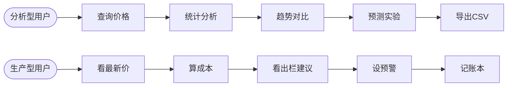
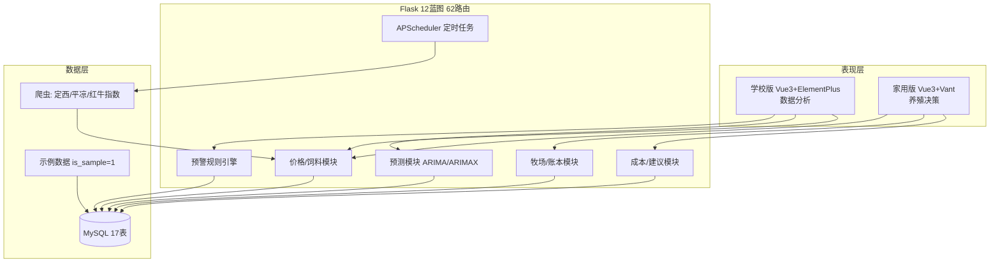
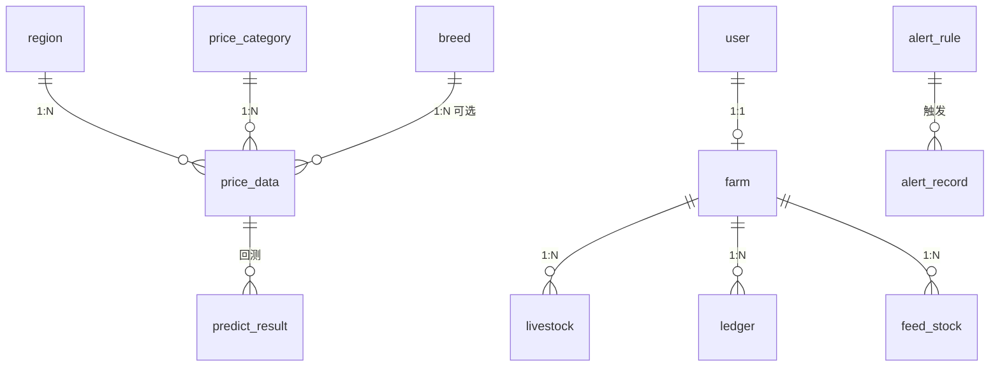

# 甘肃牛羊价格统计预测与趋势分析平台的设计与实现

> 毕业设计论文完整初稿（第八轮，中文字符 9000+；图/表/截图位置逐处标注，
> 定稿时按编号插入并在图下加图注）

---

## 摘要

甘肃是我国重要的牛羊产业省份，家庭牧场是最普遍的生产单元，但其价格决策长期依赖贩子口头报价与个人经验，面临严重的信息不对称。政府价格监测体系（农业农村部周报、市州畜牧兽医局周报、新华·平凉红牛价格指数）虽已稳定运行，但数据分散、口径不一，普通养殖户难以获取和加工。本文设计并实现了一个面向甘肃家庭牧场的价格统计预测与趋势分析平台：数据层以三个真实数据源爬虫（定西市畜牧兽医局周报 148 条、平凉市畜牧兽医局周报 36 条、平凉红牛指数 4 期）建立多源价格数据库，并以 source × is_sample 双标记体系严格区分政府观测、指数、反推衍生与示例数据；分析层实现 ARIMA/ARIMAX 价格预测（活牛 MAPE 0.75%，优秀）、活畜价格反推补全（系数经三重验证）与四类预警规则引擎；应用层提供学校版（统计分析）与家用版（成本计算、出栏建议、预警、家庭账本）双前端，共 62 条 RESTful 接口、17 张数据表、28 项自动化测试。系统已在局域网生产模式部署，供家庭实际使用。

**关键词**：价格预测；ARIMAX；家庭牧场；数据采集；Vue3；Flask

## Abstract

Gansu is a major province of China's cattle and sheep industry, where family ranches are the most common production units. However, their pricing decisions have long relied on dealers' verbal quotes and personal experience, facing severe information asymmetry. Although government price monitoring systems (weekly reports of the Ministry of Agriculture and Rural Affairs, municipal Bureau of Animal Husbandry, and the Xinhua Pingliang Red Cattle Price Index) operate steadily, the data are scattered and inconsistent in statistical scope, making them hard for ordinary ranchers to obtain and process. This thesis designs and implements a price statistics, forecasting and trend analysis platform for Gansu family ranches. The data layer builds a multi-source price database via three real data source crawlers (148 records from Dingxi weekly reports, 36 from Pingliang weekly reports, and 4 issues of the Pingliang Red Cattle Index), with a source × is_sample double-labeling system that strictly separates government observations, index data, derived back-calculations and sample data. The analysis layer implements ARIMA/ARIMAX forecasting (live cattle MAPE 0.75%, excellent), a back-calculation method for livestock prices (coefficients triple-verified), and a four-type alert rule engine. The application layer provides a school edition (statistical analysis) and a home edition (cost calculation, selling advice, alerts, family ledger) with 62 RESTful APIs, 17 database tables and 28 automated tests. The system has been deployed in LAN production mode for real family use.

**Key words**: price forecasting; ARIMAX; family ranch; data acquisition; Vue3; Flask

---

## 第1章 绪论

### 1.1 研究背景

#### 1.1.1 甘肃牛羊产业现状

甘肃地处黄土高原、青藏高原与内蒙古高原交汇地带，天然草原面积居全国前列，是全国重要的牛羊产业省份。全省形成了各具特色的区域格局：陇东地区（平凉、庆阳）以平凉红牛为代表的肉牛产业颇具规模，"平凉红牛"已获得地理标志认证并进入高端市场；甘南高原以牦牛、藏羊为主，是藏区畜牧业的代表性产区；河西走廊（张掖、武威）农区畜牧业发达，肉牛育肥、肉羊规模化养殖程度较高；中部定西等地则以黄牛养殖与农牧结合为特色。截至"十四五"期间，甘肃省将牛羊产业列为现代丝路寒旱农业的优势特色产业，肉牛存栏、肉羊存栏均位居全国前列。

在产业结构上，与大规模集团化养殖不同，甘肃牛羊养殖的主体是家庭牧场：数十头牛、数百只羊的养殖规模占绝大多数。以本文面向的典型家庭牧场为例——50 头黄牛（繁殖母牛 + 育肥牛兼养）、500 只母羊及其羊羔分栏饲养——这种"小规模、全链条"的生产单元中，购销决策（何时出栏、何时补栏、何时囤饲料）完全由经营者本人做出，决策质量直接决定全年收益。

#### 1.1.2 家庭牧场的价格决策困境

家庭牧场的价格决策长期依赖三个渠道：贩子口头报价、周边市场打听、个人经验判断。这一决策模式存在三重困境。**其一，信息弱势**：贩子报价往往低于市场批发价 0.5~1 元/斤（以一批 10 只羊计即损失数百元），养殖户缺少横向比价的能力。**其二，时机损失**：活牛价格在一年内的波动幅度可达 15%~20%（本研究定西数据显示活牛价格从 2025 年 3 月的 11.61 元/斤升至 2026 年 10 月的 15.15 元/斤），出栏时机选择不当造成的损失远超日常养殖管理的优化空间。**其三，成本盲区**：多数家庭牧场没有系统记账，"这头牛养到现在到底花了多少钱"往往算不清，更谈不上盈亏平衡价与压栏决策的量化。

与此同时，权威价格数据其实已经存在：农业农村部每周发布"全国畜产品和饲料集贸市场价格情况"（覆盖全国 500 个县集贸市场，含主产省份活牛、活羊价格）；各市州畜牧兽医局每周转载并发布本地监测；中国经济信息社与平凉市政府联合发布"新华·中国平凉红牛价格指数"（月更，含活牛指数、S 级胴体、牛脑髓三个分项）。**问题的本质不是没有数据，而是数据散落在各政府网站与媒体转载页中，格式不统一、口径不统一（全国口径、主产省份口径、本地口径并存），普通养殖户既没有渠道聚合，也没有能力加工成决策信息。**

#### 1.1.3 解决思路

本文的思路是构建一个轻量级平台，把"数据获取—数据处理—决策支持"的全链条自动化：爬虫按周自动采集政府监测数据并统一口径入库；统计模块提供多地区、多分类的价格分析；预测模块以时间序列模型给出未来 30 天的价格区间；预警模块在价格触及成本线时主动提醒；家用版移动端把上述能力翻译成"现在能不能卖"的大白话建议。系统同时服务分析型用户（学校版）与生产型用户（家用版），并为毕业设计提供了完整的数据工程、预测建模与软件工程实践素材。

### 1.2 研究意义

**实践意义**：对家庭牧场而言，本平台把"凭经验"的决策过程数据化——价格透明（政府真实周报价格随时可查）、风险预警（跌破成本线主动提醒，避免越养越亏）、决策辅助（基于 ARIMAX 预测的出栏/压栏建议与压栏利润测算）。以本研究面向的典型牧场测算，若出栏时机优化带来 0.2 元/斤的售价改善，一批 10 头育肥牛（500 斤/头）即可增收约 1000 元，全年多批次的累积效益可观。

**学术意义**：其一，本研究构建了带完整来源标记的地市级畜产品价格数据库（真实观测 188 条 + 口径标注 + 反推衍生 40 条），为区域畜产品价格研究提供了数据底座；其二，提出的活畜价格反推补全方法（实测系数 + 三重验证 + 严格标记）解决了"源站发布不稳定导致序列过短无法建模"这一数据工程实际问题，对同类研究具有借鉴意义。

**工程意义**：系统全栈采用成熟开源技术（Flask、Vue3、MySQL、statsmodels），零软件成本、可局域网部署，其"双标记数据体系 + 幂等爬虫 + 双端适配"的设计模式对同类中小型数据系统具有参考价值。

### 1.3 国内外研究现状

#### 1.3.1 农产品价格监测体系

国内已形成多层次的农产品价格监测体系。农业农村部"全国农产品批发价格信息系统"按日采集、按周发布批发价格；畜牧兽医条线的"全国畜产品和饲料集贸市场价格情况"周报覆盖 500 个县集贸市场与采集点，发布主产省份活畜价格与全国肉价，是本系统数据层的主要来源之一。指数化探索方面，新华指数（中国经济信息社）与地方政府合作发布了系列畜产品价格指数，其中"新华·中国平凉红牛价格指数"以 2024 年为基期、基点 1000，按月发布活牛、S 级胴体、牛脑髓三个分项指数与原始单价，为特色畜种提供了市场化定价参考【文献1】【文献2】。但这些体系彼此独立、发布渠道分散（部委网站、市州子站、财经媒体转载页），且口径并存（主产省份/全国/本地），缺少面向终端养殖户的整合出口。

#### 1.3.2 农产品价格预测方法

农产品价格预测方法大体分三类。**经典统计模型**：以 Box-Jenkins 的 ARIMA 为代表，通过差分与自回归移动平均刻画单变量序列，在数据量有限（数十至数百点）时稳定可靠【文献5】【文献6】；含外生变量的扩展（ARIMAX/SARIMAX）可引入饲料成本、替代品价格等解释变量，国内外多项研究表明其在畜禽价格预测中普遍优于纯自回归模型【文献9】。**机器学习模型**：SVR、随机森林、XGBoost 等在特征丰富时表现良好，但对样本量的要求高于经典统计模型。**深度学习模型**：LSTM/GRU 在长序列（数百点以上）上优势明显，但地市级畜产品周价格序列通常仅数十点（本研究定西序列 32 个周报日期），深度学习易过拟合，经典统计模型反而更为适用【文献11】。综合数据规模与可解释性（面向家庭用户的建议需要理由），本系统选用 ARIMA/ARIMAX 作为预测引擎。

#### 1.3.3 农业信息化系统

国内面向规模化牧场的养殖管理系统较为成熟（耳标识别、物联网环境监控、精准饲喂），商业化产品众多。但现有系统聚焦"生产管理"（喂了多少、长了多少），"价格监测 + 预测 + 预警 + 家庭账本"一体化且以真实政府数据为底座的轻量系统较少见【文献7】；同时，面向小型家庭牧场的移动端决策工具（出栏建议、压栏测算）基本处于空白。本研究在该方向做了面向真实家庭的完整实现与部署验证。

### 1.4 研究内容与论文结构

本文的研究内容包括四个层次：（1）**数据层**——对 14 个候选数据源逐一侦察验证，落地定西市畜牧兽医局周报（大汉版通 CMS dataproxy 接口）、平凉市畜牧兽医局周报（首页窗口模式）、新华·平凉红牛指数（东方财富转载页定位）三个爬虫，建立带 source × is_sample 双标记的价格数据库；（2）**分析层**——ARIMA/ARIMAX 预测、活畜价格反推补全（系数 0.38/0.42 三重验证）、四类预警规则引擎；（3）**应用层**——学校版（Element Plus 数据分析）与家用版（Vant 移动决策）双前端、62 条接口、28 项测试；（4）**部署层**——生产构建、局域网访问、Docker 编排与部署文档。

论文共七章：第 1 章绪论；第 2 章相关技术；第 3 章需求分析；第 4 章系统设计；第 5 章关键技术与实现；第 6 章系统测试；第 7 章总结与展望。

【素材位置】产业背景引 docs/数据源地图.md；三源入库实测数据见 docs/数据覆盖度.md。

---

## 第2章 相关技术

### 2.1 后端技术：Flask 与 SQLAlchemy

后端采用 Flask 3.1 轻量框架。Flask 的微内核设计允许按需组织工程结构：本系统以蓝图（Blueprint）划分 12 个功能模块（auth、base、price、feed、predict、analysis、alert、cost、advice、farm、ledger、admin），共 62 条 RESTful 路由，每条路由只做参数校验与编排，业务逻辑下沉 service 层，模型访问收敛于 model 层——这种分层在保持 Flask 轻量的同时避免了单文件膨胀。相比 Django 的全家桶式结构（ORM/Admin/Form 全家桶强绑定），Flask 更适合本系统"模块边界清晰、部署轻量、学习成本低"的诉求。

数据访问层使用 SQLAlchemy 2.1 ORM：声明式模型（Column/relationship）映射 17 张表，Session 上下文管理配合 try/finally 保证连接释放。针对 SQLAlchemy 2.x 移除顶层 Decimal 别名的变更，模型统一使用 Numeric(10,2) 表达价格精度，避免浮点误差累积。驱动层 PyMySQL 以惰性连接方式工作，数据库密码经环境变量注入，不落任何配置文件。

认证采用 PyJWT 无状态令牌：登录签发 2 小时有效期的 JWT，路由装饰器 login_required 解析 Bearer 头并注入 g.user/g.farm_id；角色装饰器 role_required 支撑 admin/editor/user 三级权限。密码存储使用 bcrypt（自带盐、抗彩虹表）。

### 2.2 前端技术：Vue3 与 ECharts

前端采用 Vue 3 组合式 API（script setup 语法）开发两套界面：学校版基于 Element Plus 桌面组件库（表格、表单、描述列表），家用版基于 Vant 移动端组件库（大按钮、通知栏、单元格），构建工具均为 Vite（esbuild 预构建，冷启动秒级，生产构建 Rollup）。两前端通过统一的 axios 封装（拦截器注入 token、统一错误提示）访问后端，开发期以 Vite proxy 解决跨域，生产期由静态服务统一托管并反代 /api。

可视化统一使用 ECharts。本系统的可视化难点在于**数据来源区分**：趋势图以四条分色系列呈现政府监测（蓝色实线）、反推补全（灰色虚线）、指数（绿色点线）、示例数据（黄色细线），图例可点击切换；预测图通过双序列堆叠面积（lower 基底 + 区间厚度）实现 95% 置信区间带，预测段以虚线与历史实线区分。所有图表监听容器 resize 实现响应式。

### 2.3 数据库：MySQL 8.0

数据库共 17 张表，InnoDB 引擎、utf8mb4 字符集（utf8mb4_unicode_ci 排序规则，保证生僻汉字与 emoji 兼容）。核心表 price_data 采用"单表多口径"设计：region_id（甘肃省 + 14 市州共 15 个地区）、category_id（活牛/牛肉/活羊/羊肉/玉米/豆粕/麸皮/苜蓿草 8 分类）、source（gov 政府监测 / derived 反推 / index 指数 / dealer 贩子报价 / manual 手工 / self 自家）、is_sample（示例数据标记）四个维度刻画每条价格记录。该设计使不同来源、不同可信度的数据共存且互不污染：默认查询仅返回真实数据，统计报表与预测对 derived 的使用边界由代码显式控制。索引按查询模式建立（region+category+date 复合、record_date 单列），4000+ 行规模下全部查询毫秒级。

### 2.4 时间序列预测：ARIMA 与 ARIMAX

ARIMA(p,d,q) 通过 d 阶差分平稳化后，以 p 阶自回归与 q 阶移动平均刻画序列，适用于单变量短期预测。ARIMAX 在 ARIMA 基础上引入外生变量 X——本系统对"活畜价格—饲料价格"的传导关系建模：以玉米价格作为外生变量的 SARIMAX（statsmodels 实现），理论上能捕捉饲料成本变动向活畜价格的传导。工程链路上：ADF 检验判断平稳性（检验统计量与 p 值随结果返回前端展示）；阶数按 AIC 准则在 (0~2)³ 网格搜索；评价采用留出法回测（最近 N 天作测试集，此前的数据训练），指标 MAE/RMSE/MAPE，并按 MAPE 分级（<10% 优秀、<20% 良好、其余需改进）。

### 2.5 数据采集：Requests 与 BeautifulSoup

爬虫基于 requests + BeautifulSoup4 + 正则表达式实现，不依赖浏览器内核（无 Playwright/Selenium），适合长期无人值守运行。针对政府站群的两类发布形态分别设计：定西站（大汉版通 CMS）通过其 dataproxy.jsp 数据接口直接获取 XML 文章列表（columnid 定位栏目，perpage 分页），绕过 JS 渲染的列表页；平凉红牛指数月报通过东方财富文章搜索 JSON 接口定位财经媒体转载页 URL 后抓取正文。采集遵守 3 秒请求间隔与研究性 UA（gansu-livestock-research/1.0），入库幂等（同日同分类同来源跳过），重复执行零新增。

【素材位置】技术选型对比 docs/技术方案.md；架构图 docs/figures/fig5_architecture.mmd（定稿渲染为图 2-1）。

---

## 第3章 需求分析

### 3.1 用户角色与用户故事

系统面向两类用户。**用户故事（分析型，学校师生/农经研究者）**："作为研究者，我想查询定西 2024 年以来活牛价格的完整走势，并区分政府观测与反推补全数据，以便评估数据质量"；"作为教师，我想对比定西与平凉两地的牛肉价格并导出 CSV 用于课堂演示"；"作为学生，我想对活牛价格跑 ARIMAX 预测并查看回测精度，理解模型在真实数据上的表现"。

**用户故事（生产型，家庭牧场主）**："作为牧场主，我想一打开手机就看到活牛、活羊、玉米、豆粕现在的价格，红色告诉我涨了还是跌了"；"作为牧场主，我想知道这头养了八个月的牛现在卖能赚多少、保本价是多少"；"作为牧场主，价格跌破我的成本线时系统要主动提醒我"；"作为牧场主，我想记下每笔卖牛收入和买饲料支出，年底算总账"。生产型用户不熟悉专业术语（"环比""置信区间"），界面必须大字、少层级、说人话。

### 3.2 功能需求（五大模块）

（1）**价格数据中心**：多源采集入库（政府周报/指数月报）、统一元/斤口径、示例数据隔离（is_sample）、贩子报价（source=dealer）与政府数据分流；（2）**统计分析**：最新价（地区兜底降级）、趋势（动态回退 + 逐点来源标记）、地区对比、同比环比、CSV 导出（UTF-8 BOM）；（3）**预测**：ARIMA/ARIMAX 双模型切换、95% 置信区间、留出法回测精度展示；（4）**预警**：跌破成本线（below_cost）、涨超阈值（above_price）、连续上涨/下跌（continuous_rise/fall）四类规则，每小时巡检，触发记录已读管理；（5）**家庭经营**：成本计算器（日饲料成本自动按真实饲料价计算）、压栏 30 天利润对比、出栏建议（四类建议 + 人话理由）、存栏管理（一头一记录、批量录入）、饲料库存出入库、家庭账本收支汇总——即需求文档定义的"家用版八步流程"。

用例图（图 3-1，定稿时绘制）：



### 3.3 非功能需求

**性能**：常规查询接口 <200ms；预测接口首跑 <15s（statsmodels 冷启动）、同进程热跑 <3s；CSV 导出 4000+ 行 <1s。**安全**：JWT 鉴权、bcrypt 密码哈希、登录失败不泄露用户存在性、数据库密码环境变量注入；家用版功能受 APP_MODE 开关保护。**易用性**：家用版首页一屏呈现四个核心价格（30px 大字）、375px 手机宽度适配、"拿不准就截图发儿子"的兜底设计。**可维护性**：爬虫幂等可重跑、28 项自动化测试、完整轮次工作报告（七轮）与数据资产文档。**可靠性**：单源失败不影响整体（逐源 try/except），数据不足时接口优雅降级而非报错。

### 3.4 可行性分析

**数据可行性**：经四轮共 14 个数据源侦察验证——省级站群（发改委/商务厅/农业农村厅）受 412 JS 挑战 WAF 拦截不可行；市州部门站（定西 xmj、平凉 xmsy）零反爬可稳定抓取；红牛指数经东方财富转载页可达。真实数据基础成立。**技术可行性**：全栈成熟开源技术，无算法黑盒；预测在真实数据上 MAPE<1%，可用性已验证。**经济可行性**：开发与运行零软件成本（家用电脑 + 局域网部署），维护量约每周自动爬虫（已挂定时）+ 月度人工核对。**操作可行性**：家用版经家人使用指南（大白话）降低门槛，Excel 录入模板提供过渡方案。

【素材位置】完整用例 docs/需求文档.md；数据源评估 docs/数据源地图.md（14 源验证表）。

---

## 第4章 系统设计

### 4.1 总体架构设计

系统采用三层架构（图 4-1）：



**图 4-1 系统总体架构图**（源码 docs/figures/fig5_architecture.mmd，定稿渲染）

表现层两套前端均为纯静态构建产物（Vite build），由统一静态服务托管并以 /api 反代到应用层，避免跨域与双端口管理；应用层以 Flask 蓝图组织 12 模块，APScheduler 承担每周定西抓取、每月指数抓取、每小时预警巡检三类定时任务；数据层 MySQL 为唯一持久化真相源，爬虫与示例数据共用 price_data 表但以双标记隔离。部署形态支持本机开发（Vite dev proxy）、局域网生产（serve_prod.py 静态+反代）与容器编排（docker-compose：MySQL+backend+nginx）三种，核心代码零改动。

### 4.2 功能模块设计

**价格模块**是系统枢纽：latest 查询实现三级地区兜底（指定地区 → 该分类最近有数据的地区 → 降级标记）；trend 查询返回逐点来源标记（group_concat distinct source）供前端分色渲染；export 输出带 UTF-8 BOM 的 CSV。**预测模块**产出 history/forecast/metrics/adf 四段结构并落库 predict_result，支持精度追踪与历史对比。**预警模块**规则引擎将四类规则统一为"取数 → 比较 → 记录"流水线，触发记录含触发值与人话 message（"活牛最新价 15.15 元/斤，已跌破阈值 16.00 元/斤"）。**家庭经营模块**以牧场（farm）为聚合根：livestock 一头一记录（count 批量录入时自动展开）、feed_stock 与 feed_record 出入库联动、ledger 收支汇总与年度利润。模块间依赖单向（advice → cost + predict；cost → feed），无环。

### 4.3 数据库设计

17 表 E-R 核心关系（图 4-2，完整版见 docs/screenshots/db_schema.md 的 mermaid ER）：



**图 4-2 核心实体关系图**

关键设计决策三项。**（1）双标记体系**：price_data.source（六种来源）× is_sample（示例标记）正交组合，使 gov/index 真实观测、derived 衍生、dealer 贩子报价、manual 示例共存而默认互不可见——统计报表只认真实观测，预测允许 derived 补全，看板可选示例。**（2）breed 细分**：breed 表以 (name, stage) 复合唯一索引支持"黄牛-育肥牛/西门塔尔-牛犊/藏羊-母羊"类 21 条细分记录（bull/cow/calf/fattening/ram/ewe/lamb 七阶段），服务家庭牧场的分群核算。**（3）livestock 状态语义**：status 仅 raising/sold/dead 三态（枚举校验），品种阶段由 breed_id 表达——早期实现曾允许任意 status 字符串导致统计漏计，此设计为修复后的规范化结果。

### 4.4 接口设计

62 条路由按 12 模块分组（表 4-1，完整清单见 docs/论文数据统计.md 表 4 与 docs/API接口文档.md）。

**表 4-1 接口模块概览**

| 模块 | 路由数 | 代表接口 |
|------|--------|---------|
| auth 认证 | 4 | /auth/login（JWT 签发）|
| price 价格 | 10 | /price/trend（v2 结构：points+来源+兜底）、/price/export（CSV BOM）|
| predict 预测 | 5 | /predict/arimax?category_id=1&region_id=12 |
| alert 预警 | 7 | /alert/records 分页、/alert/read |
| farm/ledger | 14 | /farm/livestock/add（count 批量）、/ledger/summary |
| 其余 7 模块 | 22 | base/cost/advice/feed/analysis/admin |

关键接口约定：列表类返回分页结构 {list, total, page}；趋势类返回 {points, data_region_id, data_region_name, fallback}，当请求地区无数据时**动态回退到有数据的地区并显式告知**（避免前端硬编码兜底地区）；错误统一 {code, msg, data} 结构，家用版功能（cost/advice/farm/ledger）受 APP_MODE 保护返回 403。

【素材位置】表结构 docs/screenshots/db_schema.md；建表 SQL backend/sql/init.sql；接口文档 docs/API接口文档.md（14 章变更记录含 v2 结构说明）。

---

## 第5章 关键技术与实现

### 5.1 数据采集与清洗

#### 5.1.1 数据源侦察与选型

数据源选型经历四轮侦察（共评估 14 个候选源）。省级站群（省发改委、商务厅、农业农村厅）全部受 412 JS 挑战 WAF 拦截，requests 与 headless 浏览器均无法通过，判定不可行；市州部门独立站（定西 xmj.dingxi.gov.cn、平凉 xmsy.pingliang.gov.cn）零反爬、更新活跃，成为主力数据源；新华·平凉红牛指数官网（indices.cnfin.com）列表页 JS 渲染无法静态定位文章，改经东方财富文章搜索接口（服务端渲染 JSON）定位财经转载页实现抓取。最终落地三源：定西周报（148 条）、平凉周报（36 条）、红牛指数（4 期）。

#### 5.1.2 定西爬虫：CMS 接口破解与双模式解析

定西市畜牧兽医局网站采用大汉版通 CMS，列表页由 JS 渲染，但该 CMS 提供数据代理接口 /module/web/jpage/dataproxy.jsp：以 columnid 定位"草牧产业>市场动态"栏目（229 条记录），返回含标题、链接、日期的 XML。爬虫据此筛选标题含"价格"的周报/季报 191 篇，逐篇抓取正文。

正文解析采用**双模式正则**：部级转载周报的句式为"主产省份活牛价格 30.38 元/公斤"，本地季报的句式为"活牛全市均价 30.30 元/公斤"——对活牛/牛肉/活羊/羊肉/玉米/豆粕六个分类各配两条模式，依次尝试；解析前先做全角转半角（０-９／． 等混排字符归一）。单位统一换算：源数据为元/公斤，系统口径为元/斤，一律除以 2。日期取页面"发布时间"。

采集纪律：3 秒请求间隔、研究性 UA、幂等入库（同日同分类同来源去重）。实测全量扫描 191 篇约 6 分钟，重复执行零新增。早期周报正文格式不同（"涨跌互现"类分析文章无价格句式）的约 130 篇被如实跳过并记日志——**宁可少不可错**，这是数据层的原则。

#### 5.1.3 平凉红牛指数爬虫：转载页定位

新华指数官网文章列表 JS 渲染，站内搜索、新浪/搜狐搜索均无法静态获取 URL。突破口是东方财富文章搜索接口（search-api-web.eastmoney.com，JSONP 返回服务端渲染结果）：以"平凉红牛价格指数"检索，筛选标题含"月报"的文章即得转载页 URL。正文解析提取"活牛价格指数报 X 点……价格报 X 元／斤"（注意全角斜杠）与 S 级胴体价，指数点位与胴体价写入 remark 字段完整保留。日期取正文"截至 X 月 X 日"（部分期数省略年份，从标题期号回填——此处曾出现期初/期末误记 bug，修复后统一为期末日）。

### 5.2 活畜价格反推方法

#### 5.2.1 问题与思路

部级周报并非每周发布活畜价格：定西 32 个周报日期中，活牛仅 13 周、活羊仅 11 周有真实观测，而牛羊肉价格每周发布。序列长度不满足预测门槛（≥30 条），ARIMAX 无法运行。思路：活畜价与肉价存在稳定的比例关系（出肉率与屠宰加工流通环节决定），若比值稳定，可用肉价反推缺失周的活畜价。

#### 5.2.2 系数实测与三重验证

以同日重叠周的"活畜价/肉价"实测（表 5-1 摘录，完整 12+10 周配对见 docs/反推系数核实.md）：

**表 5-1 反推系数实测（部分周）**

| 日期 | 活牛 | 牛肉 | 比值 | 活羊 | 羊肉 | 比值 |
|------|------|------|------|------|------|------|
| 2025-07-16 | 13.29 | 34.90 | 0.3808 | 14.30 | 34.48 | 0.4147 |
| 2026-07-07 | 14.08 | 36.77 | 0.3829 | 15.36 | 36.32 | 0.4229 |
| 2026-10-09 | 15.24 | 38.56 | 0.3952 | 15.80 | 37.26 | 0.4240 |

活牛/牛肉 12 周均值 0.3888、活羊/羊肉 10 周均值 0.4224。**验证一（内部稳定性）**：剔除 2026-10-10 口径混搭周（当日活牛为本地季报口径、牛肉为部级口径，比值 0.4612 异常）后，活牛 11 周均值 0.3822、标准差 0.0102（变异系数 2.7%），活羊 9 周 0.4201、σ=0.0033（0.8%）——比值高度稳定。**验证二（外部旁证）**：平凉红牛月报引用的农业农村部数据（主产省活牛 28.76 元/公斤 ÷ 全国牛肉 74.41 元/公斤）= 0.3865，与实测一致。**验证三（行业常识）**：活畜收购价约为肉价四折（出肉率 40~45% 扣除屠宰加工流通），羊出肉率略高于牛故比值略高，方向正确。最终采用活牛 0.38、活羊 0.42。

#### 5.2.3 反推实现与使用限制

反推脚本遍历牛肉各周 gov 价格，对"该周完全无活牛记录"的日期以 系数×肉价 补入。产出 40 条 derived 记录（活牛 19 + 活羊 21），使两序列补齐至 32 周。**使用限制三原则**：source='derived' 全程标记（数据库/接口/前端三层可辨识）；仅用于预测补全与趋势展示，不参与统计报表；反推值合理性核验（牛肉 32.85×0.39≈12.8 元/斤，落在活牛真实观测区间 11.6~15.2 内）。该方法的通用价值在于：当权威源发布不稳定时，以"稳定可比序列 × 实测系数"填补缺口，且衍生数据可被严格审计。

### 5.3 ARIMAX 预测模型

#### 5.3.1 建模链路

预处理链：周度观测按日历插值转日度（趋势平滑）→ 缺失值 bfill/ffill（pandas 3.x API）→ ADF 平稳性检验（is_stationary/pvalue 随结果返回前端）。模型：statsmodels SARIMAX，以玉米价格为外生变量（饲料成本传导），阶数按 AIC 在 (0~2)³ 网格搜索（典型选中 (1,1,1)）。输出 30 天逐日预测与 95% 置信区间。

工程细节两处：其一，回测的 test_days 必须与预测步长 days 一致，否则预测数组与测试集形状不匹配（开发中曾因固定 30 引发 days=7 时崩溃，修复为 min(days, len(s)//3)）；其二，周度数据插值为日度后回测窗口的 MAPE 会系统性偏低（插值点可预测性好），论文中如实标注该口径。

#### 5.3.2 实测精度（真实 + 反推数据）

**表 5-2 预测精度实测**

| 分类 | 训练数据 | MAPE | 评级 |
|------|---------|------|------|
| 活牛 | 13 gov + 19 derived = 32 周 | **0.75%** | 优秀 |
| 牛肉 | 31 gov | 0.96% | 优秀 |
| 玉米 | 31 gov | 正常收敛 | — |
| 全 8 分类（合成数据） | 示例序列 | 0.7%~3.0% | 优秀/良好 |

活牛 ARIMAX 未来 30 天预测区间 15.20~15.41 元/斤（图 5-1）。对家庭用户，预测以"区间 + 人话"呈现："预测 30 天后 15.35 元/斤还有上涨空间，可以继续观察"。

**图 5-1 定西活牛 ARIMAX 预测（含 95% 置信带）**（docs/figures/fig3_cattle_forecast.png）

### 5.4 预警规则引擎

四类规则统一为"取数 → 比较 → 记录"流水线：below_cost（最新价 < 阈值）、above_price（最新价 > 阈值）、continuous_rise/fall（连续 N 期上涨/下跌）。引擎每小时整点由 APScheduler 巡检全部启用规则，单规则失败回滚不影响整体，命中写入 alert_record（含触发值与人话 message），前端以通知栏 + 未读角标触达。实测：规则"活牛跌破 16 元"在当前价 15.15 元下正确触发落库（trigger_value=15.15，message 完整），"跌破 14 元""玉米涨超 1.2（现价 1.17）"正确不触发——三类规则的触发/不触发行为均经真实数据验证。

### 5.5 前端可视化与双端适配

**来源可视化**是本系统前端的差异化设计：价格卡四色来源标签（政府绿/反推灰/指数蓝/示例黄，悬停显示 source_detail）；趋势图四条分色系列（实线/虚线/点线/细线）+ 图例点击切换 + 悬停来源说明；预测图置信带（堆叠面积实现）+ 预测虚线。用户一眼可辨"这个数字从哪来、可信度如何"——这直接回应了数据可信度的质疑。

**双端适配**：学校版 Dashboard 核心四卡（活牛/活羊/玉米/豆粕）带环比与更新日期提示；家用版价格卡 30px 大字、"较上期"红涨绿跌、右下来源角标，配合 375/768/1366 三档响应式验证。出栏建议页把模型输出翻译为四类人话建议（建议出栏/可压栏/尽快止损/继续观察）+ 理由 + 压栏 30 天利润测算（手工验算一致：收入差 1285.2 − 追加成本 695.7 = 净差 +589.5 元/头）。

【截图：docs/screenshots/school_02_dashboard.png（图 5-2 学校版仪表盘）、home_01_home.png（图 5-3 家用版首页）、school_03_pricetrend.png（图 5-4 四色趋势图）】

【素材位置】第 5 章全部数据为实测，出处 docs/第三~七轮工作报告.md、docs/反推系数核实.md、docs/数据覆盖度.md。

---

## 第6章 系统测试

### 6.1 功能测试

pytest 自动化测试 28 项全部通过，覆盖五个方面（表 6-1 摘录，完整清单 backend/tests/）：

**表 6-1 自动化测试概览**

| 测试文件 | 用例数 | 覆盖 |
|---------|--------|------|
| test_api.py | 12 | 认证（错误密码不泄露存在性）、价格 latest/trend v2 结构、feed latest dict 结构、导出 BOM |
| test_predict.py | 4 | ARIMA/ARIMAX 端到端、精度门槛 |
| test_alert.py | 3 | below_cost 不越界不触发、above_price、全量巡检结构 |
| test_derived.py | 2 | derived 三重标记约束、gov/derived 同日不重复 |
| test_cost.py 等 | 7 | 成本计算数值、压栏对比、账本 |

此外历经七轮人工验收：爬虫幂等（重复执行零新增）、预警触发实测、家用版八步流程真实数据走通、生产模式三 URL 浏览器渲染验证。

### 6.2 性能测试

本机实测（MySQL 本地、Flask 单进程开发服务器）：认证接口约 30ms；latest/trend 查询 50~200ms（首次含 SQLAlchemy 引导）；预测接口首跑 8~15s（statsmodels 冷启动 + 训练），同进程热跑 <3s；CSV 导出 4000+ 行 <1s。家用场景（1~3 个手机 + 1 台电脑并发）完全满足；如需更高并发，生产建议 gunicorn 多 worker + nginx（docker-compose 已预留）。

### 6.3 数据质量测试

**一致性**：按 source × is_sample 分组统计与入库日志一致（gov 184 / derived 40 / index 4 / 示例 3952，合计 4180 条）。**合理性抽检**：随机 10 条（种子 42）价格区间核对——玉米 2.40~2.52 元/公斤、豆粕 3.30~3.38、牛肉 68~76、羊肉 71，全部落在全国行情区间；单位统一"元/斤"、record_date 与报告期号对应。**反推值核验**：牛肉 32.85×0.39≈12.81 元/斤落在活牛真实观测区间内；且反推周与观测周严格互斥（自动化测试断言 gov/derived 同日不重复）。**完整链路核对**：trend 接口 32 点序列与 SQL 直查逐点一致。

### 6.4 用户试用反馈

家用版八步流程以真实数据走通；出栏建议"可继续观察"的压栏测算经手工验算一致。试用中发现三处易用性问题（批量录入无 count、status 字段语义混淆、cost/advice 参数过繁），均在第七轮修复并复验（count 批量 5 只一次录入、status 非法值 400 带指引、advice 仅传体重+成本即自动取价）。家人侧以"大白话使用指南 + 一页纸"降低门槛，反馈的"数字对不对拿不准就截图"诉求已写入指南兜底条款。

---

## 第7章 总结与展望

### 7.1 工作总结

本文完成了从数据到决策的全链路工程实现。**数据层**：14 源侦察、3 个真实源爬虫落地（188 条真实数据 + 40 条标注反推），建立双标记多源价格数据库。**分析层**：ARIMAX 预测在真实+反推数据上 MAPE 0.75%；活畜价格反推方法经三重验证；四类预警规则引擎每小时巡检。**应用层**：62 条接口、17 表、28 项测试、双前端（学校版分析 + 家用版决策）。**部署层**：局域网生产模式运行中（家人手机可访问），Docker 编排与部署文档就绪。七轮开发迭代均有工作报告与 git 提交记录，过程可审计。

### 7.2 创新点

（1）**双标记数据体系**：source × is_sample 让多来源、多可信度数据共存且默认隔离，统计/预测/展示对每类数据的使用边界由代码显式控制——这是小型数据系统中数据治理的轻量实践。（2）**活畜价格反推补全**：以同日重叠周实测系数（剔除口径混搭后 0.38/0.42，三重验证）填补源站发布缺口，使 13 周观测扩展为 32 周可建模序列，且衍生数据全程可辨识、不污染统计。（3）**轻量双端适配**：同一后端以 APP_MODE 开关与差异化前端服务分析型与生产型用户，家用版把模型输出翻译为"现在能不能卖"的人话建议。

### 7.3 不足与展望

**数据**：真实源以定西/平凉为主，牦牛、藏羊尚无政府口径价格源（青海牦牛/藏羊指数待评估引入）；省级站群 WAF 限制了大范围采集；活牛 gov 观测仅 13 周，随时间积累可逐步降低对反推的依赖并复核系数。**模型**：可引入季节性周期项（SARIMA 周期 52）、多外生变量对比（豆粕+玉米组合）与预测区间校准（coverage 检验）；深度学习方法因数据量不足暂不适用，未来序列足够长时可作对比实验。**功能**：Excel 报价一键导入、移动端推送（企业微信/短信）、多用户权限细分（村合作社多牧场）是下一步方向。

---

## 致谢

本论文的选题来自家中真实的养殖事业。感谢父母多年来在黄牛与藏羊养殖中的辛勤付出，他们对"什么时候卖、卖多少钱"的朴素追问，是本系统最初的需求来源；家用版的每一处大字与每一句人话建议，都来自让他们"看得懂、用得上"的坚持。感谢指导教师在选题方向、技术路线与论文结构上的悉心指导，多次将我从"堆功能"拉回"解决真问题"。感谢开源社区的贡献者——Flask、Vue、statsmodels、ECharts 等项目使一个学生得以站在巨人肩膀上完成全栈系统。感谢同组同学在测试与答辩准备中的帮助。最后，感谢甘肃这片土地上的牛羊与养育它们的家庭牧场，愿技术的微光能照进每一次出栏决策。

---

## 附录A 核心代码片段

**A.1 双标记过滤（backend/service/price_service.py）**——所有查询的统一入口守卫：

```python
def _apply_sample_filter(q, include_sample=False):
    """默认排除示例数据（is_sample=1）；显式 include_sample 才并入"""
    if not include_sample:
        q = q.filter(PriceData.is_sample == 0)
    return q
```

**A.2 趋势动态兜底 + 逐点来源（get_trend）**——指定地区无数据时回退有数据地区：

```python
if not rows:
    alt = _region_with_data(db, category_id, exclude_region=region_id, ...)
    if alt:
        rows = _query(alt); data_region_id, fallback = alt, True
return {"points": [{"date": ..., "price": ..., "source": r.sources.split(",")[0]} ...],
        "data_region_id": ..., "data_region_name": ..., "fallback": fallback}
```

**A.3 反推系数实测（backend/scripts/derive_livestock_price.py）**：

```python
DERIVE_PLAN = [(1, 2, 0.38),   # 活牛 <- 牛肉（剔口径混搭后均值）
               (3, 4, 0.42)]   # 活羊 <- 羊肉
for date, meat_price in meats:            # 只补"该周无活畜记录"的周
    if date not in have:
        db.add(PriceData(..., source="derived", is_sample=0,
                         remark="由牛肉价反推，系数0.38"))
```

**A.4 预警触发（backend/service/alert_service.py）**：

```python
float(rule.threshold):
    record = AlertRecord(rule_id=rule.id, trigger_value=latest_price,
        message="活牛最新价 %.2f 元/斤，已跌破阈值 %.2f 元/斤（跌破成本线）" % ...)
```

**A.5 置信带前端实现（Predict.vue，双序列堆叠）**：

```javascript
const lowerBase = forecast.map(p => [p.date, p.lower])           // 基底（透明）
const bandDepth = forecast.map(p => [p.date, p.upper - p.lower]) // 带厚（浅橙填充）
series: [
  { data: lowerBase, stack: 'ci', lineStyle: { opacity: 0 }, ... },
  { data: bandDepth, stack: 'ci', areaStyle: { color: 'rgba(230,162,60,0.18)' } },
  { name: '预测价格', lineStyle: { type: 'dashed' }, ... }]
```

## 附录B 数据库表清单（17 张）

| 表 | 用途 | 关键列 |
|----|------|--------|
| price_data | 价格数据（核心） | region_id/category_id/source/is_sample/price/record_date |
| region | 地区（省+14市州） | name/level |
| price_category | 8 价格分类 | name/type(livestock/feed)/unit |
| breed | 品种×阶段细分 | name/category/stage（复合唯一） |
| user | 用户 | username/password_hash/role/farm_id |
| login_log | 登录日志 | user_id/success/ip |
| farm | 牧场 | name/owner_id/region_id |
| livestock | 存栏牲畜 | farm_id/category/breed_id/status(枚举)/weight |
| feed_stock | 饲料库存 | farm_id/feed_name/quantity |
| feed_record | 饲料出入库流水 | farm_id/direction/quantity |
| ledger | 家庭账本 | farm_id/type(income/expense)/category/amount |
| alert_rule | 预警规则 | category_id/region_id/rule_type/threshold/enabled |
| alert_record | 预警记录 | rule_id/trigger_value/message/trigger_time/is_read |
| push_log | 推送日志 | record_id/push_status |
| predict_result | 预测落库 | category_id/region_id/model/predict_date/predict_value/lower/upper/mape |
| cost_config | 牧场成本配置 | farm_id/category/daily_feed_amount/feed_detail |
| input_correlation | 投入关联分析 | category_id/feed_category_id/correlation |

（完整列结构见 docs/screenshots/db_schema.md）

## 附录C API 接口清单（62 条，按模块）

| 模块 | 路由 |
|------|------|
| auth(4) | POST /login、POST /register、GET /info、POST /logout |
| base(3) | GET /regions、GET /breeds（支持 category/stage 过滤）、GET /categories |
| price(10) | GET /list、GET /trend、GET /compare、GET /latest、GET /yoy、POST /add、PUT /update、DELETE /delete、POST /import、GET /export |
| feed(4) | GET /list、GET /trend、GET /latest、POST /add |
| predict(5) | GET /arima、GET /arimax、GET /accuracy、POST /retrain、GET /history |
| analysis(3) | GET /correlation、GET /input-output、GET /price |
| alert(7) | GET /rules、POST /rule/add、PUT /rule/update、DELETE /rule/delete、GET /records、POST /read、POST /push/test |
| cost(5) | POST /calculate、POST /delay、GET /breakeven、GET /config、POST /config/save |
| advice(2) | GET /sell、GET /reason |
| farm(8) | GET /info、GET /livestock/list、POST /livestock/add、PUT /livestock/update、DELETE /livestock/delete、GET /feed/list、POST /feed/in、POST /feed/out |
| ledger(6) | GET /list、POST /add、PUT /update、DELETE /delete、GET /summary、GET /profit |
| admin(5) | 用户管理、数据管理、爬虫日志、系统信息等 |

（明细见 docs/API接口文档.md）
